# LendLoop

**Borrow what you need. Lend what you don't.**

LendLoop is a tool-lending board for a neighborhood. Neighbors list the tools they rarely use, others ask to
borrow them for a date range, and the owner approves or declines. Every change in a loan's status sends an email
through an n8n workflow, and a daily n8n workflow reminds borrowers of overdue loans. Each loan page shows that
automation activity ("Reminder sent 2 days ago"). The stack is Next.js (App Router), Clerk, Convex (self-hosted)
and n8n. Everything except Clerk runs locally in Docker.

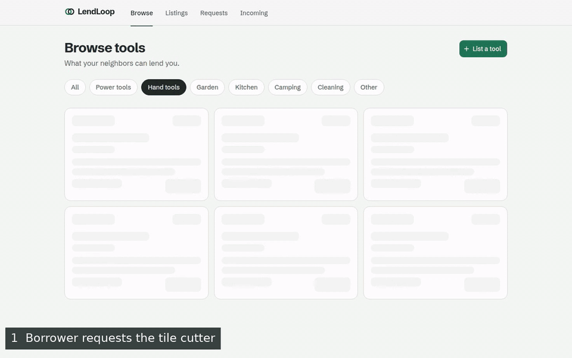

*Request → approve → the notification email in Mailpit → the activity on the loan (27 s).*

## Contents

1. [Screenshots](#screenshots)
2. [Quick start](#quick-start)
3. [Environment variables](#environment-variables)
4. [Architecture](#architecture)
5. [Roles and access control](#roles-and-access-control)
6. [Integration design](#integration-design)
7. [Security and data minimization](#security-and-data-minimization)
8. [Testing](#testing)
9. [Trade-offs and known limitations](#trade-offs-and-known-limitations)
10. [Running this in production](#running-this-in-production)
11. [AI-assisted development](#ai-assisted-development)

More detail on the integration (endpoints, payloads, failure modes) is in
[docs/architecture.md](docs/architecture.md).

## Screenshots

| Public landing (phone) | Browse with the category filter | Request sheet | Incoming: needs your action |
|---|---|---|---|
| 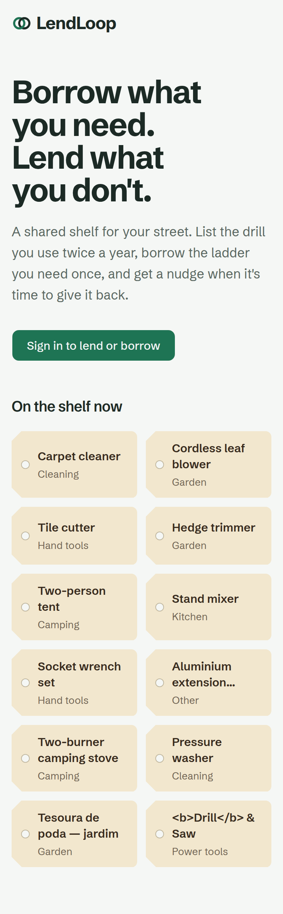 | 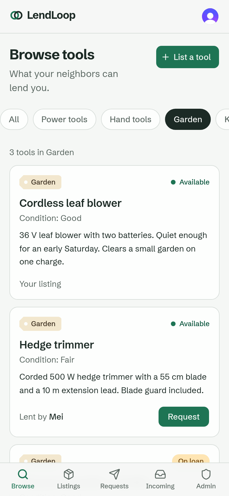 | 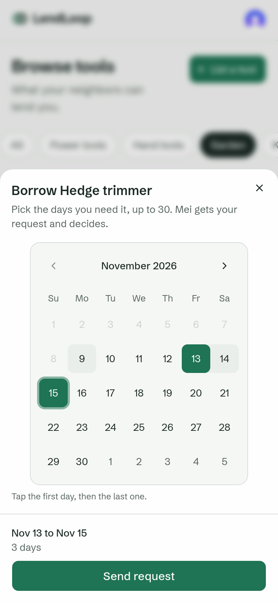 | 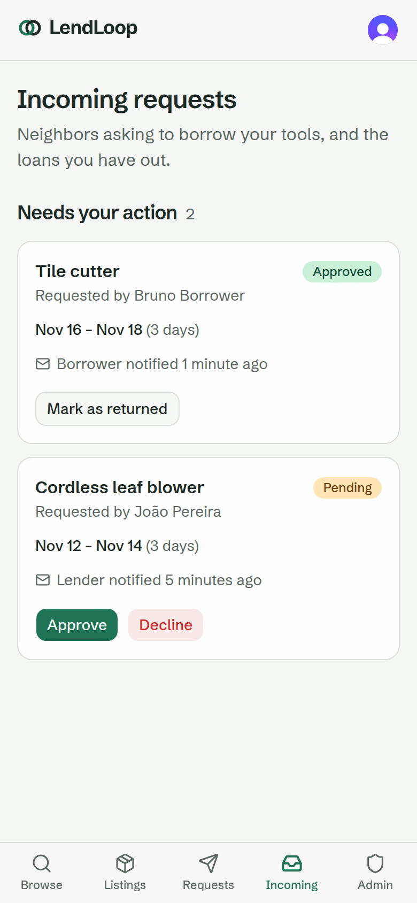 |

**Loan detail with its timeline and automation activity (desktop)**

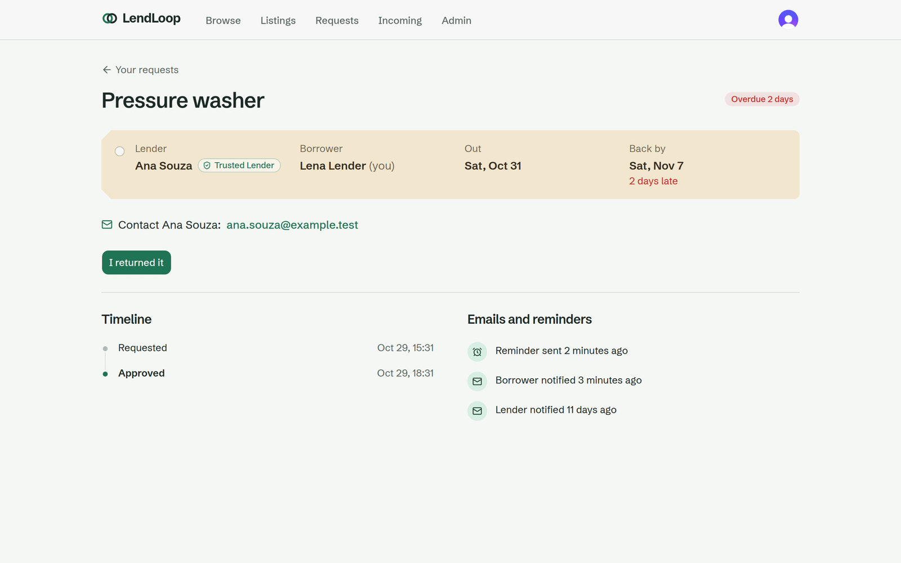

**Admin → Automation: a failed n8n run reported by the error workflow**

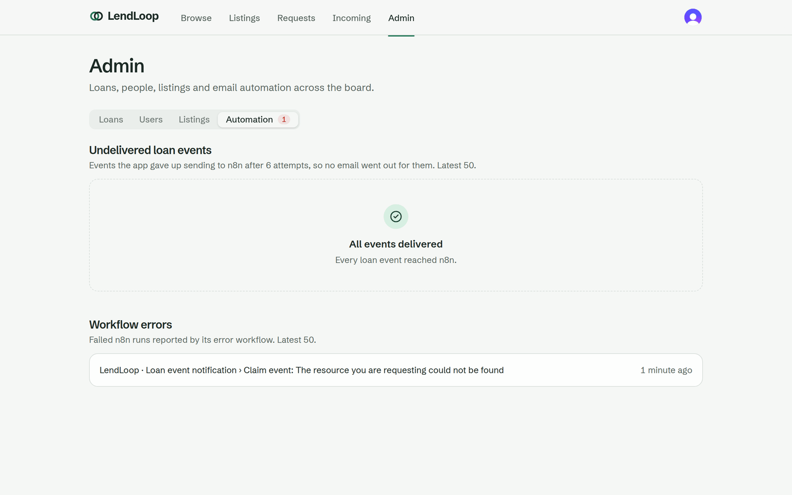

**The notification workflow in n8n**

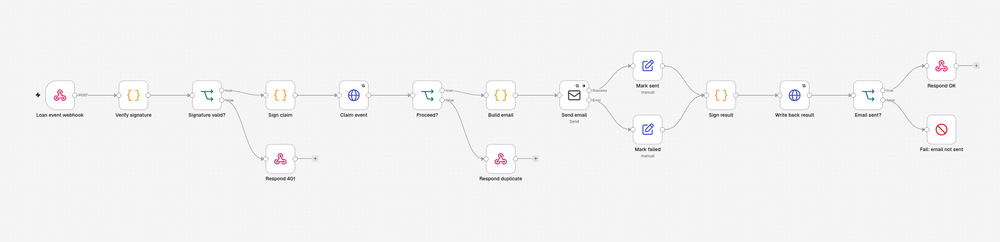

More: [landing (desktop)](docs/media/landing-desktop.png) ·
[browse (desktop)](docs/media/browse-garden-desktop.png) ·
[request sheet (desktop)](docs/media/request-sheet-desktop.png) ·
[incoming (desktop)](docs/media/incoming-desktop.png) ·
[loan detail (phone)](docs/media/loan-detail-mobile.png) ·
[automation tab (phone)](docs/media/admin-automation-mobile.png) ·
[reminder email in Mailpit](docs/media/mailpit-reminder.png) ·
[ops email for a failed run](docs/media/mailpit-ops-error.png) ·
[n8n executions with the failed run](docs/media/n8n-executions.png)

All data in the screenshots comes from the seed script and two Clerk test accounts.

## Quick start

### Prerequisites

- Docker with Compose v2, and `openssl` (the setup script generates secrets with it).
- Node.js 22 or later.
- A free Clerk account. Clerk is the only cloud dependency.

### 1. Clerk

1. Create an application at [dashboard.clerk.com](https://dashboard.clerk.com) with email sign-in.
2. Activate the Convex integration at
   [dashboard.clerk.com/apps/setup/convex](https://dashboard.clerk.com/apps/setup/convex). This makes Clerk issue
   session tokens with `"aud": "convex"`, which Convex checks.
3. Customize the session token (**Configure → Sessions → Customize session token**). The existing claims include
   `"aud": "convex"`. Keep it, and add `email` and `name`:

   ```json
   {
     "aud": "convex",
     "email": "{{user.primary_email_address}}",
     "name": "{{user.full_name}}"
   }
   ```

   Convex creates the user row from these verified claims on first sign-in (`users.ensureCurrent`). Without
   `email`, sign-in fails with a message pointing back to this step.
4. Create `.env.local` in the repo root with three values from **Configure → API keys**:

   ```bash
   NEXT_PUBLIC_CLERK_PUBLISHABLE_KEY=pk_test_...
   CLERK_SECRET_KEY=sk_test_...
   # The Frontend API URL, no trailing slash
   CLERK_JWT_ISSUER_DOMAIN=https://<your-instance>.clerk.accounts.dev
   ```

### 2. Install and set up the stack

```bash
npm ci
./scripts/setup.sh
```

`setup.sh` is idempotent: it only creates what is missing, so you can run it again at any time. It:

1. generates random secrets with `openssl rand -hex 32` (the two HMAC secrets in `.env`, the n8n encryption key
   in `.secrets/`), keeping any that already exist;
2. starts the containers (`docker compose up -d --wait`): Convex backend and dashboard, n8n, Mailpit;
3. writes the Convex URLs and an admin key to `.env.local`. It regenerates the key when the stored one is
   rejected, which happens after `docker compose down -v`;
4. sets the Convex deployment env: the Clerk issuer, both HMAC secrets and the n8n webhook URL;
5. pushes the Convex functions (`npx convex dev --once`);
6. runs `scripts/n8n-import.sh`, which creates the "Mailpit SMTP" credential, imports the three workflows from
   `n8n/workflows/`, publishes them and restarts n8n so the webhook and the schedule are registered.

### 3. n8n owner account

Open n8n at <http://localhost:5678>. On the first visit n8n asks you to create an owner account (local to your
machine). The workflows are already imported and published.

If the script could not publish them, it prints this fallback. Open each workflow and click **Publish**:
"LendLoop · Loan event notification", "LendLoop · Overdue reminders" and "LendLoop · Error handler". n8n only runs
an error workflow that is published.

### 4. Seed data and your account

```bash
npx convex run seed:dev
```

This creates three neighbors (Ana, João, Mei), ten tools across every category and loans in every status,
including an overdue one. Pending and approved seed loans send real emails, which you can see in Mailpit.

Then:

1. Start the app (`npm run dev`, below), open <http://localhost:3000> and sign in once. This creates your user row.
2. Give your account some data: two listings (one with a pending request) and an overdue loan you borrowed.

   ```bash
   npx convex run seed:dev '{"attachEmail":"you@example.com"}'
   ```

3. Make yourself an admin. This is the only way to grant admin: an internal function that needs the deployment
   admin key, so there is no path to it from the app.

   ```bash
   npx convex run users:promoteToAdmin '{"email":"you@example.com"}'
   ```

### 5. Run the app

```bash
npm run dev
```

If you edit files in `convex/`, also run `npx convex dev` in a second terminal to push them on save.

### Service URLs

| Service | URL | Notes |
|---|---|---|
| App (Next.js, on the host) | <http://localhost:3000> | `npm run dev` |
| Convex dashboard | <http://localhost:6791> | sign in with `CONVEX_SELF_HOSTED_ADMIN_KEY` from `.env.local` |
| n8n | <http://localhost:5678> | owner account created on first visit |
| Mailpit (all emails) | <http://localhost:8025> | SMTP on :1025 |
| Convex API | <http://127.0.0.1:3210> | queries, mutations, websocket |
| Convex HTTP actions | <http://127.0.0.1:3211> | `/automation/*`, called by n8n |

Every host port is bound to `127.0.0.1` and can be moved with the optional `*_PORT` variables in `.env` (see
`.env.example`), for example to run two copies side by side.

### Running the overdue workflow on demand

The workflow runs daily at 09:00 UTC. To run it now, either:

- open "LendLoop · Overdue reminders" in n8n and click **Execute workflow** (it starts from the "Run now" manual
  trigger), or
- from the shell:

  ```bash
  docker compose run --rm --no-deps n8n execute --id=LendLoopOverdue01
  ```

  It prints the execution as JSON. That output includes the reminder data, borrower emails included, so don't
  paste it anywhere.

Each overdue loan gets at most one reminder per UTC day, so a second run on the same day sends nothing new.

### Resetting

```bash
docker compose down -v
./scripts/setup.sh
npx convex run seed:dev
```

`down -v` deletes the Convex database and n8n's data, owner account included. Mailpit has no volume, so its inbox
is gone whenever its container is recreated. The setup script regenerates the Convex admin key. Sign in again, then repeat `attachEmail` and `promoteToAdmin`.

## Environment variables

There are four places a variable can live:

- **`.env`**: read by docker compose; created by `setup.sh`.
- **`.env.local`**: read by Next.js and the Convex CLI. You add the Clerk keys; `setup.sh` adds the rest.
- **Convex deployment env**: set by `setup.sh` with `npx convex env set`, and read by Convex functions.
- **n8n env**: set in `docker-compose.yml`, and read by the workflows' Code nodes through `$env`.

Neither `.env` nor `.env.local` is committed. `.env.example` lists the names with empty values.

| Name | Lives in | Purpose | Read by |
|---|---|---|---|
| `NEXT_PUBLIC_CLERK_PUBLISHABLE_KEY` | `.env.local` (you) | Clerk frontend key | Next.js (browser and server); CSP fallback |
| `CLERK_SECRET_KEY` | `.env.local` (you) | Clerk backend key for the middleware | Next.js server only (`proxy.ts`) |
| `CLERK_JWT_ISSUER_DOMAIN` | `.env.local` (you) → Convex env (`setup.sh`) | Clerk Frontend API URL; the issuer of the session JWT | `convex/auth.config.ts`; `next.config.ts` (CSP) |
| `NEXT_PUBLIC_CONVEX_URL` | `.env.local` (`setup.sh`) | Convex API URL for the app | Next.js; CSP `connect-src` |
| `CONVEX_SELF_HOSTED_URL` | `.env.local` (`setup.sh`) | Convex CLI target | Convex CLI, `npm run smoke` |
| `CONVEX_SELF_HOSTED_ADMIN_KEY` | `.env.local` (`setup.sh`) | Deployment admin key: deploys, `npx convex run`, internal functions | Convex CLI, `npm run smoke` |
| `CONVEX_TO_N8N_SECRET` | `.env` → n8n env and Convex env | HMAC secret for Convex → n8n | `convex/delivery.ts`; n8n "Verify signature" |
| `N8N_TO_CONVEX_SECRET` | `.env` → n8n env and Convex env | HMAC secret for n8n → Convex | n8n signing nodes; `convex/lib/httpSigned.ts`; `npm run smoke` |
| `N8N_ENCRYPTION_KEY` | a file in `.secrets/` (`setup.sh`), mounted into n8n as `N8N_ENCRYPTION_KEY_FILE` | Encrypts n8n's stored credentials | n8n itself (not visible through `$env`) |
| `N8N_LOAN_EVENTS_WEBHOOK_URL` | Convex env (`setup.sh`) | Outbox target, `http://n8n:5678/webhook/lendloop-loan-events` | `convex/delivery.ts` |
| `LENDLOOP_CONVEX_SITE_URL` | n8n env (compose) | Where n8n calls Convex, `http://convex-backend:3211` | n8n Code nodes |
| `LENDLOOP_APP_URL` | n8n env (compose) | Base for the links in emails, `http://localhost:${APP_PORT}` | n8n "Build email" |
| `N8N_EDITOR_BASE_URL` | n8n env (compose) | Execution links in ops emails follow the host port | n8n |
| `N8N_BLOCK_ENV_ACCESS_IN_NODE=false`, `NODE_FUNCTION_ALLOW_BUILTIN=crypto` | n8n env (compose) | Let Code nodes read `$env` and use `crypto` for HMAC ([trade-off](#the-n8n-env-trade-off)) | n8n |
| `COMPOSE_PROJECT_NAME`, `CONVEX_PORT`, `CONVEX_SITE_PORT`, `CONVEX_DASHBOARD_PORT`, `N8N_PORT`, `MAILPIT_UI_PORT`, `MAILPIT_SMTP_PORT`, `APP_PORT` | `.env` (optional) | Host ports and project name; defaults in the URL table | compose, `setup.sh`, `n8n-import.sh`, `npm run smoke` |

**What n8n receives:** the two HMAC secrets, its own encryption key and the internal URLs. It never gets the Convex
admin key or the Clerk secret, and it doesn't need them: everything it does in Convex goes through the five signed
HTTP endpoints.

The compose file also sets fixed n8n options: UTC timezone, execution history kept for 7 days
(`EXECUTIONS_DATA_MAX_AGE=168`) for both successes and errors, diagnostics and personalization off.

## Architecture

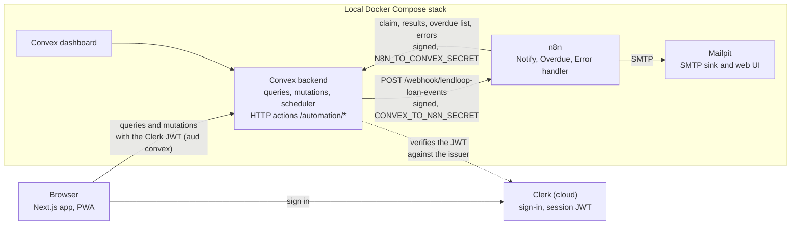

- **Next.js** runs on the host. It renders the pages and talks to Convex directly from the browser. The public
  landing page reads the public tool list on the server and caches it for 30 s.
- **Convex** holds all data and all rules: every public query and mutation checks the caller, every loan
  transition goes through one state machine, and loan events leave through a transactional outbox.
- **n8n** sends every email. It has no database access: it reads and writes through five HMAC-signed HTTP actions.
- **Mailpit** catches all SMTP traffic, so no real email leaves the machine.

### One loan event, end to end

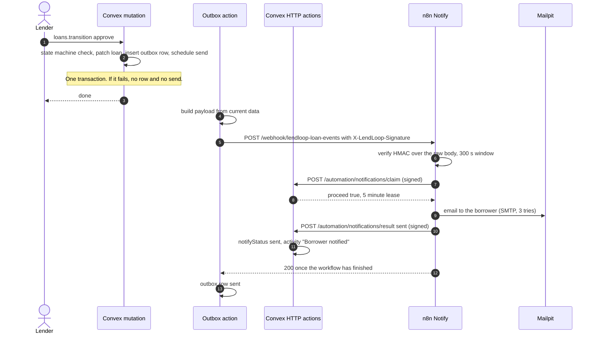

The loan page subscribes to its activity, so "Borrower notified" appears without a reload.

### The overdue flow

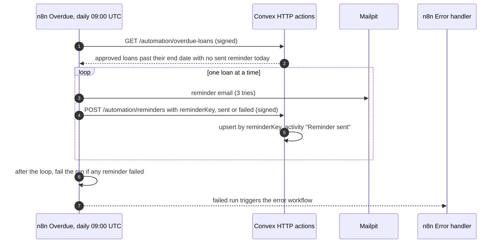

A loan is overdue when its status is `approved` and its end date is before today (UTC). A `return_claimed` loan
gets no reminders until the lender confirms or disputes the return.

### Data model

| Table | What it holds | Notes |
|---|---|---|
| `users` | Clerk subject, display name, email, role, Trusted Lender flag | Email stored for one purpose (see [Security](#security-and-data-minimization)) |
| `tools` | owner, name, category, condition, description, `active`/`removed` | Removal is a soft delete with who and why |
| `loans` | tool, borrower, lender, start/end date (UTC `YYYY-MM-DD`), status | A request and the loan it becomes are one row |
| `webhookDeliveries` | the outbox: `eventId`, type, recipient, attempts, last error, claim lease, n8n result | The payload is built at send time, not stored. Also the loan's status timeline |
| `reminders` | `reminderKey` = `<loanId>:<YYYY-MM-DD>`, status, n8n execution id | Unique per loan per day |
| `automationEvents` | notification/reminder sent or failed, delivery failed, workflow error | Feeds the loan activity and the admin panel. No PII |
| `auditLog` | actor (or null for the CLI), action, target, metadata | Admin actions and promotions |

### Loan state machine

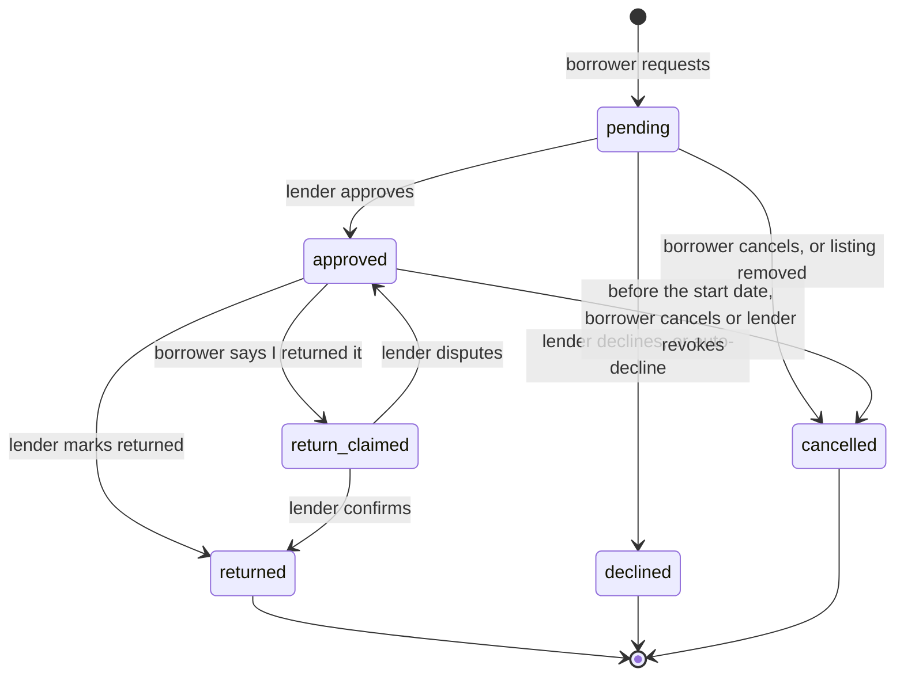

The table of transitions × allowed actor lives in [`convex/lib/loans.ts`](convex/lib/loans.ts). One function,
`checkTransition`, decides both what the server accepts and which buttons the UI shows. Every transition enqueues
exactly one event for the other party. The rules around it:

- **Request:** the start date can't be in the past, and the end date must be on or after the start date. A loan
  lasts at most 30 days. The tool must be active and not your own. The request is rejected if it overlaps your own
  pending request for the tool, or an approved or return-claimed loan of the tool. A borrower can have at most 5
  open pending requests.
- **Approval:** a request whose end date has passed shows as "Expired" and can only be declined. Approval is
  rejected if the dates overlap an approved or return-claimed loan of the tool. Approving declines
  every other pending request for overlapping dates and notifies those borrowers ("dates no longer available").
- **Calling it off:** before the start date, the borrower can cancel and the lender can revoke an approved loan.
  After that, only the return path is left.
- **Return:** "I returned it" moves the loan to `return_claimed`. A dispute puts it back to `approved`, where it
  counts as overdue again.
- **Overdue tools** stay "On loan" on the board, and admins see "Overdue since …" in the listings tab.

## Roles and access control

Two roles, `user` and `admin`, stored on the Convex `users` row. "Party" means the loan's lender (tool owner) or
borrower.

| Action | Anonymous | User: own tool / own loan | User: someone else's | Admin |
|---|---|---|---|---|
| See the public list (name and category only) | ✅ | ✅ | ✅ | ✅ |
| Browse tools with condition, availability, lender name | ❌ | ✅ | ✅ | ✅ |
| List a tool (max 50 active listings) | ❌ | ✅ | — | ✅ |
| Edit or delete a listing | ❌ | ✅ (delete blocked while lent out) | ❌ | own only |
| Remove any listing, with a reason | ❌ | ❌ | ❌ | ✅ (audited) |
| Request to borrow | ❌ | ❌ (own tool) | ✅ | ✅ (as a user) |
| Approve, decline, revoke, mark returned, confirm or dispute a return | ❌ | lender only | ❌ | ❌ unless lender |
| Cancel, claim a return | ❌ | borrower only | ❌ | ❌ unless borrower |
| View a loan's detail | ❌ | parties | ❌ | ✅ (all loans) |
| See the counterpart's email | ❌ | parties, from approval until 14 days after the return | ❌ | ❌ unless a party |
| See all loans, filter by status or overdue | ❌ | ❌ | ❌ | ✅ |
| See users (no emails), set Trusted Lender | ❌ | ❌ | ❌ | ✅ (audited) |
| See automation health | ❌ | ❌ | ❌ | ✅ |
| Grant admin | ❌ | ❌ | ❌ | ❌ (CLI only) |

**Where it is enforced:** in Convex functions, never only in the UI.

- Every public query and mutation starts with `getViewer`, `requireUser` or `requireAdmin`
  ([`convex/lib/auth.ts`](convex/lib/auth.ts)). The viewer is resolved from the verified Clerk token subject.
- Ownership and party checks compare against rows loaded from the database (`tool.ownerId`, `loan.lenderId`,
  `loan.borrowerId`). No function trusts a user id or role sent by the client.
- Loan actions check the actor before the status, so a non-party, admins included, always gets `FORBIDDEN` and
  learns nothing about the loan's state.
- Functions that clients must never call are `internal*`: the outbox sender, the automation handlers, the seed,
  the smoke-test helpers and `promoteToAdmin`. They run only from other functions, from the signed HTTP actions or
  with the deployment admin key.
- The Next.js middleware (`proxy.ts`) sends signed-out visitors on any page except `/` and `/offline` to sign-in.
  That gate is for navigation. The data is protected by Convex on every call.

**Admin bootstrap:** only `npx convex run users:promoteToAdmin`, which needs the deployment admin key. No path in
the app grants admin.

**Audit log:** admin listing removals (`tool.removed`, with the reason), Trusted Lender changes
(`user.trusted_set`) and promotions (`user.promoted`, actor `null` for the CLI) go to `auditLog`. An owner deleting
their own listing is recorded on the tool (`removedBy`) rather than in the audit log.

## Integration design

### Transactional outbox

A mutation that changes a loan also inserts a `webhookDeliveries` row and schedules `delivery.send` with
`ctx.scheduler.runAfter(0, …)` ([`convex/lib/outbox.ts`](convex/lib/outbox.ts)). Convex mutations are
transactions, so the state change, the outbox row and the scheduled send commit together or not at all. There is
no "loan approved but nobody was told" and no "email sent for a change that rolled back".

The action builds the payload from current data at send time. The payload holds only what the email needs: the
event id and type, the recipient's name and email, the tool name, the loan's id, dates and status, and the actor's
name, or `null` for system events. A cron job in `convex/crons.ts` runs every 5 minutes and re-schedules outbox
rows stuck in `pending`, for example after a backend restart during a send.

### Signatures

Both directions use the same scheme ([`convex/lib/signature.ts`](convex/lib/signature.ts); the n8n Code nodes use
Node's `crypto` with the same algorithm):

```
X-LendLoop-Signature: t=<unix seconds>,v1=<hex HMAC-SHA256>
signed string:        `${t}.${METHOD}.${path}.${rawBody}`     (UTF-8; empty body for GET)
```

- **Tolerance:** the receiver rejects a timestamp more than 300 s from its clock, in either direction.
- **Raw body:** the signature is checked over the exact bytes received, before JSON parsing. Re-serialized JSON
  could differ byte for byte.
- **Constant-time comparison:** XOR over the hex digests in Convex, `crypto.timingSafeEqual` in n8n.
- **Method and path are signed,** so a signature is valid for exactly one request. A captured signature can't be
  replayed against a different route within the 300 s window, even with a body that would parse there. The tests
  try a signature from one route on every other route, and the smoke test sends a real signature from
  `GET /automation/overdue-loans` with a reminder body. Both expect 401.
- **Separate secrets per direction.** `CONVEX_TO_N8N_SECRET` signs events to n8n and `N8N_TO_CONVEX_SECRET` signs
  calls to Convex. A leak of one direction doesn't allow forging the other.
- **Failures:** every failure gets the same generic 401. Only the reason (`missing`, `malformed`, `stale`,
  `mismatch`, `not_configured`) is logged, never the header, body or secret. If the secret is unset, every request
  is rejected.
- **Rotation:** the `v1=` label leaves room for a second key; see [production](#running-this-in-production).

### Idempotency

| Write | Key | Rule |
|---|---|---|
| Email for a loan event | `eventId` (uuid per outbox row) | n8n claims the event before sending. The claim answers `proceed: true` to one caller at a time (a 5-minute lease), `proceed: false, reason: "done"` once the email went out, `reason: "in_progress"` while another run holds the lease. A `failed` result releases the lease. |
| Notification result | `eventId` | Repeating a status records nothing. `sent` is final; `failed` can be upgraded to `sent`, never the reverse. One activity entry per recorded change. |
| Overdue reminder | `reminderKey` = `<loanId>:<YYYY-MM-DD>` | Upsert. A repeat returns `200 {"recorded": false}` with no new row and no new activity. `failed` can become `sent`, never the reverse. A loan with a `sent` reminder today is not listed again. |
| Workflow error | n8n `executionId` | Recorded once per failed execution. |

### Retries

- **Convex → n8n:** a 10 s timeout per attempt. On a non-2xx answer or a network error, the outbox retries after
  30 s, 2 min, 10 min, 30 min and 2 h. After the sixth failed attempt the row is `failed` and the loan gets a
  "Could not reach the automation service" entry. Admins see the row under Admin → Automation → "Undelivered loan
  events".
- **Inside n8n:** the SMTP and HTTP Request nodes retry 3 times, 2 s apart. The Overdue workflow handles one loan
  per pass, so a retry never re-sends an email that already went out, and one failed email doesn't stop the others.
- **Webhook answers:** the Notify webhook answers only after the workflow finishes.
  - 200 when the email was sent, and 200 `{"duplicate": true}` when the event was already done.
  - 409 when another run holds the lease, so Convex keeps backing off until the outcome is known.
  - 500 when the email failed. The workflow wrote back `failed`, which released the lease, so the next outbox
    attempt sends the email again.

### Error workflow and where failures show up

"LendLoop · Error handler" is set as the error workflow of the other two. For every failed run it:

1. emails `ops@lendloop.local` (Mailpit) with the workflow, the failed node, the execution id and a link to the
   execution;
2. sends a signed `POST /automation/errors`, which records a `workflow_error` entry with email addresses masked.

A failure is therefore visible in three places:

- **n8n:** the execution history, kept 7 days for successes and errors.
- **Mailpit:** the ops email.
- **The app:** Admin → Automation, with "Undelivered loan events" and "Workflow errors". Per-loan failures also
  appear in that loan's activity.

The Overdue workflow fails its own run after the loop if any reminder failed, so failed reminders also reach the
error workflow.

### Delivery semantics

Delivery from Convex to n8n is at-least-once: a request that times out after n8n already sent the email is
retried. The claim turns that into effectively-once emails. A retry of a finished event gets `done`, and a retry
during a run gets `in_progress`. One window remains: n8n sends the email, then cannot record the result (Convex
unreachable through all three write-back tries). After the 5-minute lease expires, a later outbox attempt can claim
the event again and send a second email. That takes two failures in a row, and the outcome is a duplicate email,
never a lost one. Closing it fully needs an email provider that accepts an idempotency key per message.

Failure-by-failure behavior (n8n down, SMTP down, n8n crash mid-run, Convex restart) is in
[docs/architecture.md](docs/architecture.md#failure-modes).

## Security and data minimization

**Personal data**

- **The email is stored for one purpose: transactional notifications and reminders.** Storing it means delivery
  doesn't depend on the Clerk API being up or on its rate limits. It comes from the verified session token, not from
  user input. Any new use needs a review.
- **Display names** come from the token's `name` claim. When that is empty the name is "Neighbor" plus a short id,
  never derived from the email.
- **The public page gets name and category only.** `tools.listPublic` returns `{ _id, name, category }` for the
  newest 100 active tools: no owner, condition, description or availability.
- **Signed-in users see other people by name only.** Tool cards and loan rows carry the lender's name and Trusted
  Lender badge. They carry no user ids and no emails.
- **The counterpart's email is shown only after approval, and only to the two parties.** It disappears again 14
  days after the return. Admins who are not a party never see it.
- **The admin user list has no emails.** Admins moderate by name; they don't need to contact anyone.
- **Payloads to n8n carry only what the email needs.** They hold no owner ids, no other users' emails and no
  descriptions.

**Logs and stored error text**

- Convex logs structured JSON with ids and outcomes only (`eventId`, `loanId`, `type`, `status`, `attempt`,
  `durationMs`). They never hold emails, names or secrets.
- `automationEvents.detail` holds fixed strings ("Borrower notified") or workflow errors with email addresses
  replaced by `[email]`, both in the n8n error workflow and again in Convex.
- The ops email in Mailpit carries the unmasked error message, because it goes to operators.

**Input and output**

- Every Convex argument has a validator. Categories and conditions are literal unions. Text is trimmed and
  length-checked in characters, not UTF-16 units: names 1–80, descriptions up to 280, with no control or format
  characters.
- React escapes everything; no user content is rendered as HTML.
- Emails escape every user-supplied string before it reaches the HTML. A seeded tool is literally called
  `<b>Drill</b> & Saw`, and the smoke test asserts that it arrives as text.

**Browser**

- Security headers on every response, set in [`next.config.ts`](next.config.ts):
  - a Content-Security-Policy with `default-src 'self'`, `frame-ancestors 'none'`, `object-src 'none'`,
    `base-uri 'self'` and `form-action 'self'`. Connections are allowed only to Convex, Clerk and Clerk's bot
    protection, and the origins are derived from the env at build time;
  - `X-Content-Type-Options: nosniff`;
  - `Referrer-Policy: strict-origin-when-cross-origin`;
  - a `Permissions-Policy` that disables camera, microphone and geolocation.
- Clerk's browser telemetry is turned off (`telemetry={false}`).
- **The service worker caches no data.** It precaches the offline page, its static assets and the icons, and
  serves content-hashed `/_next/static/*` files cache-first. Page navigations go to the network, with `/offline`
  as the fallback. No page HTML, RSC payload, Convex or Clerk response is ever stored.

**Secrets**

- No secret is in git, in `.env.example` values or in the exported workflow JSON. Workflows reference the SMTP
  credential by name. `n8n-import.sh` creates the credential inside the container from a here-doc, so it never
  touches the repo.
- [`scripts/check-no-secrets.sh`](scripts/check-no-secrets.sh) scans every tracked file and the workflow exports
  for:
  - 64+ character hex strings;
  - Clerk secret keys;
  - Convex admin key assignments;
  - non-empty `"password"` values;
  - inline credential `data` or `pinData` in n8n exports.

  It prints file and line, never the value, and runs as part of `npm test`.
- `.env` and `.env.local` are git-ignored, and `setup.sh` writes them with mode 600.

#### The n8n env trade-off

The n8n Code nodes compute the HMACs, so they need `crypto` and the secrets. n8n blocks both by default; the
compose file sets `N8N_BLOCK_ENV_ACCESS_IN_NODE=false` and `NODE_FUNCTION_ALLOW_BUILTIN=crypto`.

- **The cost:** anyone who can edit a workflow can read the n8n process environment.
- **The mitigation:** that environment holds only the two HMAC secrets and internal URLs. n8n's encryption key
  arrives as a mounted file (`N8N_ENCRYPTION_KEY_FILE`), so `$env` can't read it. n8n never receives the Convex
  admin key or the Clerk secret.
- **The blast radius:** a workflow editor can already send email from n8n. With the HMAC secrets they can also
  call the five automation endpoints directly:
  - mark notifications and reminders as sent or failed;
  - record workflow errors;
  - read the overdue list, which holds the overdue borrowers' names and emails.

  They cannot read or change loans, tools or users through Convex's public API.
- **In production:** limit who can edit workflows (see [production](#running-this-in-production)).

**Network and supply chain**

- Every container port is bound to `127.0.0.1`. The containers reach each other by service name.
- Images are pinned: Convex backend and dashboard by `sha256` digest, n8n `2.46.7`, Mailpit `v1.33.1`. npm
  dependencies are pinned to exact versions with a lockfile.

**What is local-dev only:** HTTP everywhere, including `N8N_SECURE_COOKIE=false` for the n8n UI on http. Also
Mailpit instead of real SMTP, a Clerk development instance, Convex on SQLite in a Docker volume, and the
smoke-test helpers in `convex/devtools.ts`. The [production section](#running-this-in-production) covers each.

## Testing

| Command | What it does |
|---|---|
| `npm test` | Runs `scripts/check-no-secrets.sh`, then Vitest: 261 tests in 17 files at the time of writing |
| `npm run smoke` | End-to-end against the running stack: 7 checks through Convex, n8n and Mailpit |
| `npm run typecheck` | `next typegen` and `tsc --noEmit` |
| `npm run lint` | ESLint |
| `scripts/check-no-secrets.sh` | The secret scan on its own |

**What the Vitest suite covers** (`convex-test` runs the real functions against the real schema in memory):

- **RBAC matrix:** each mutation and query as anonymous, another user, the owner or party, and an admin. That
  includes "admins can't act on other people's loans", "`users.adminList` never includes email" and
  "`listPublic` exposes only id, name and category".
- **State machine:** every action × every status × lender / borrower / stranger, checked against the spec diagram
  written out independently. It also covers the date rules, the overlap rules, auto-decline, and "every transition
  enqueues exactly one event to the right recipient".
- **Signatures:**
  - round trip, wrong secret, tampered body, a different path or method, stale timestamps in both directions,
    malformed headers;
  - a fixed UTF-8 vector checked against Node's `crypto`, because the payload carries names like "João";
  - every route rejects unsigned, stale or tampered requests, and a signature for one route doesn't work on
    another.
- **Idempotency:** the claim lease (exclusive below 5 minutes, re-claimable after), the release on a `failed`
  result, result write-back replays, the reminder upsert and key format, and error de-duplication by execution id.
- **Outbox:** the payload contains only the spec's fields, the request is signed, 2xx marks it sent, and the full
  backoff schedule ends in `failed` with an activity entry. Network errors and missing configuration count as
  failed attempts.
- **Seed, dates (UTC, month and DST boundaries) and the UI helpers** that decide what the screens show.

**`npm run smoke`** ([`scripts/e2e-smoke.ts`](scripts/e2e-smoke.ts)) needs the stack from `setup.sh`. It creates its
own fixture each run, so it can be re-run without a reset. On success it deletes the fixture and its emails; pass
`npm run smoke -- --keep` to keep them for inspection. The 7 checks:

1. `seed:dev` runs, and every seed notification was delivered through n8n and written back.
2. A `loan.requested` email reaches the lender, with the HTML tool name escaped.
3. The Overdue workflow reminds the overdue borrower and records exactly one `sent` reminder.
4. Replaying the signed reminder write-back returns `{"recorded": false}` and adds nothing.
5. A wrong secret and a valid signature taken from another request are both rejected with 401.
6. A second Overdue run sends no new reminder for that loan.
7. Events naming João Pereira round-trip with valid signatures over UTF-8 bodies, and the email shows the name
   intact.

## Trade-offs and known limitations

- **UTC dates.** Loan dates are calendar dates interpreted in UTC. A request may start "yesterday" in UTC, a grace
  day for people west of UTC whose local today is still that date. Overdue and the reminder key also use the UTC
  date. A real product would store the neighborhood's timezone.
- **At-least-once delivery with a claim lease.** See [delivery semantics](#delivery-semantics): one narrow window
  can produce a duplicate email, never a lost one. Each failed n8n run also sends one ops email, so an SMTP outage
  produces one per retry.
- **Error workflows and the n8n CLI.** `n8n execute` starts the error workflow fire-and-forget and exits, so for
  CLI-triggered runs the ops email and the app report land only sometimes. Runs started by the schedule or the
  webhook were verified to report reliably; a manual run in the editor may not start the error workflow at all.
  The smoke test never asserts error-workflow effects after a CLI run.
- **No browser end-to-end tests in CI.** Logging in through Clerk in CI needs Clerk testing tokens. The UI flows
  were checked by hand and with scripted Playwright sessions against Clerk test users. The automated coverage is
  the Convex suite and the smoke test.
- **`convex/devtools.ts` ships with the deployment.** It holds the smoke test's fixture helpers: internal functions,
  callable only with the admin key. It is the only code that hard-deletes rows. A production build should leave it
  out.
- **Clerk development instance.** Dev keys come with Clerk's usage limits and a console warning. The
  session-token customization must be repeated on a production instance.
- **No CSP nonces.** `script-src` keeps `'unsafe-inline'`, which Next.js needs for its inline bootstrap without
  nonces. Nonces would make every page render per request and drop the static shell. The XSS defense is React
  escaping and never rendering user HTML.
- **The status timeline is read from the outbox,** since every transition writes exactly one outbox row. Pruning
  outbox rows would shorten timelines; a dedicated history table would remove that coupling.
- **Unfiltered admin loan list** returns the newest 500; filters use indexes. Pagination is the fix at scale.
- **The CSP and `NEXT_PUBLIC_*` values are fixed at build time.** Changing the Convex URL needs a rebuild.
- **Next.js also loads `.env`** (its default behavior), so the dev server's process environment holds the HMAC
  secrets. Nothing in the app reads them, and only `NEXT_PUBLIC_*` values reach the browser.
- **The middleware gates pages only.** A future Server Action or Route Handler that touches protected data must
  call `auth.protect()` itself.

## Running this in production

- **Convex.** Convex Cloud is the shortest path: managed backups, scaling and upgrades. Self-hosted: the
  backend on ECS Fargate with RDS Postgres as the database and S3 for files, exports and snapshots, behind an ALB
  with TLS. Run the dashboard only on a private network.
- **Secrets.** Keep the HMAC secrets, the n8n encryption key and the Clerk secret in AWS Secrets Manager and inject
  them into ECS task definitions. Rotate HMAC keys with dual verification: receivers accept `v1` (old) and `v2`
  (new) for a window, senders switch to `v2`, then `v1` is retired. The header's version label already allows it.
- **n8n.** Run in queue mode: main plus workers, Postgres for workflows and executions, Redis (ElastiCache) for the
  queue. Put it behind TLS and SSO, and restrict who can edit workflows with n8n roles. Because of the
  [env trade-off](#the-n8n-env-trade-off), workflow editing is equivalent to holding the HMAC secrets. Keep the
  editor off the public internet; only the Convex backend needs to reach `/webhook/*`.
- **Email.** Amazon SES instead of Mailpit, with SPF, DKIM and DMARC on the sending domain. Add bounce and
  complaint handling through SNS, and put the `eventId` in a message header so a duplicate is traceable to its
  event.
- **Clerk.** A production instance with its own keys and the same session-token claims. Add a `user.deleted`
  webhook, verified with Svix signatures, that erases or anonymizes the `users` row. Name and email go; loans stay
  for the other party's history.
- **Rate limiting.** Limit mutations per user in Convex (the per-user caps are already there; add a token bucket
  for request and transition bursts). Put AWS WAF rate rules on the n8n webhook and the Convex HTTP actions.
- **Monitoring.** Send errors to Sentry from Next.js and from Convex (log streams). Send metrics and logs to Datadog,
  using the structured `delivery.attempt` lines as they are. Alert on failed outbox rows, rows pending longer than
  10 minutes, and workflow errors.
- **Audit.** Turn on CloudTrail for infrastructure and secrets access. Retain `auditLog` and n8n execution data for
  a defined period (for example 1 year and 30 days), and export them to S3 with Object Lock for tamper evidence.
- **Backups.** Use RDS automated backups with PITR, periodic Convex exports to S3, and n8n Postgres backups. Restore
  them on a schedule to prove they work.
- **Browser e2e in CI.** Playwright with Clerk testing tokens covering request → approve → email → activity,
  against a compose stack in CI, next to `npm test` and `npm run smoke`.
- **Per-neighborhood timezone.** Store a timezone per neighborhood, and compute "today", overdue and the reminder
  key in it. Send reminders at 09:00 local.
- **Exclude devtools.** Leave `convex/devtools.ts` (and the seed) out of production deploys, for example with a
  separate Convex functions directory or a build step that drops them.
- **CSP nonces.** Move to nonce-based `script-src` through the middleware, and accept per-request rendering on
  authenticated pages.

## AI-assisted development

The brief allows LLMs, and this project was built with Claude Code. I wrote the design with it first (scope,
security and data decisions, build order), then an implementation plan with acceptance checks per task. Agents
implemented the tasks, and a separate agent reviewed each one before it was merged. The trade-offs in this README come
from that design.
