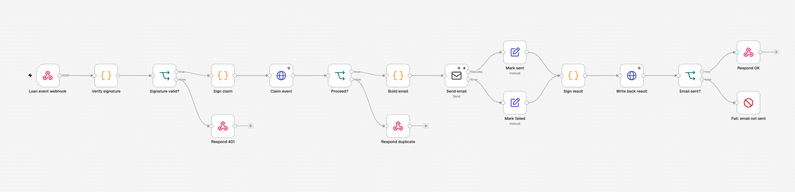

# LendLoop architecture notes

The README gives the overview. This page has the integration details: the contract between Convex and n8n, the
workflows node by node, and what happens when each part fails.

## Contract between Convex and n8n

### Convex → n8n: loan events

`POST {N8N_LOAN_EVENTS_WEBHOOK_URL}`, which is `http://n8n:5678/webhook/lendloop-loan-events` inside compose. The
request is signed with `CONVEX_TO_N8N_SECRET` over the path `/webhook/lendloop-loan-events`.

```json
{
  "eventId": "0b6c7c1e-4f0e-4a43-9a1e-2b1f6f2a8d11",
  "type": "loan.approved",
  "occurredAt": "2026-11-09T18:34:51.000Z",
  "recipient": { "email": "joao.pereira@example.test", "name": "João Pereira" },
  "tool": { "name": "Tesoura de poda — jardim" },
  "loan": { "id": "jd74…", "startDate": "2026-11-12", "endDate": "2026-11-15", "status": "approved" },
  "actor": { "name": "Ana Souza" }
}
```

- **`type`** is one of the event types below.

  | Event | Goes to |
  |---|---|
  | `loan.requested` | lender |
  | `loan.approved` | borrower |
  | `loan.declined` | borrower |
  | `loan.cancelled` | the other party; the borrower when the lender revokes or the listing is removed |
  | `loan.return_claimed` | lender |
  | `loan.returned` | borrower |
  | `loan.return_disputed` | borrower |
- **`actor`** is `null` for system events: auto-decline after another approval, and cancellation because the
  listing was removed. The email templates switch to the system wording for those.
- **`occurredAt`** is when the transition happened (the outbox row's creation). It doesn't drift with retries.
- **Current data:** the payload is built when the request is sent. A retry hours later carries the current loan
  status.

### n8n → Convex: automation endpoints

All five are Convex HTTP actions ([`convex/http.ts`](../convex/http.ts)), signed with `N8N_TO_CONVEX_SECRET`.
Bodies are validated with zod after the signature check. Each route calls one internal function in
[`convex/automation.ts`](../convex/automation.ts), which holds the idempotency rules.

| Route | Body | Answer |
|---|---|---|
| `POST /automation/notifications/claim` | `{ eventId }` | `{ proceed: true }`, or `{ proceed: false, reason: "done" \| "in_progress" }`; 404 for an unknown event |
| `POST /automation/notifications/result` | `{ eventId, status: "sent" \| "failed", executionId }` | `{ recorded }`; 404 for an unknown event |
| `GET /automation/overdue-loans` | none | `{ today, loans: [{ loanId, reminderKey, borrower: { email, name }, tool: { name }, endDate, daysOverdue }] }` |
| `POST /automation/reminders` | `{ reminderKey, loanId, status, executionId }` | `{ recorded }`; 400 if the key is not `<loanId>:<YYYY-MM-DD>`; 404 for an unknown loan |
| `POST /automation/errors` | `{ workflowName, nodeName?, executionId, message }` | `{ recorded }` |

Error answers are generic: `401 {"error":"unauthorized"}` for any signature problem and
`400 {"error":"invalid_body"}` for a body that fails validation.

### Signing, step by step

Signing a request:

```ts
const t = Math.floor(Date.now() / 1000);
const v1 = hex(HMAC_SHA256(secret, `${t}.${method}.${path}.${rawBody}`)); // UTF-8 bytes
headers["X-LendLoop-Signature"] = `t=${t},v1=${v1}`;
```

Verifying one:

1. Read the body as text, before any JSON parsing.
2. The header must match `t=<1–12 digits>,v1=<64 lowercase hex>`.
3. `|now − t| ≤ 300` seconds.
4. Recompute the HMAC over `t.METHOD.path.rawBody` and compare in constant time.
5. Only then parse the JSON and validate its shape.

The Convex side is [`convex/lib/signature.ts`](../convex/lib/signature.ts) (WebCrypto, so it runs in the Convex
runtime, Vitest and Node). The n8n side is a short block that is identical in every signing Code node, plus the
"Verify signature" node in the Notify workflow. A test vector over a UTF-8 body ("João", an em dash) pins both
implementations to the same bytes.

## The workflows



**LendLoop · Loan event notification** (`LendLoopNotify01`)

1. **Webhook:** raw body on, responds via "Respond to Webhook" nodes.
2. **Verify signature:** on failure the workflow answers 401 and stops.
3. **Claim on Convex:**
   - `done` → 200 `{"duplicate": true}`;
   - `in_progress` → 409.
4. **Build email:** one template per event type. Every user-supplied string is HTML-escaped, and the email has a
   plain-text part.
5. **Send email:** the Mailpit SMTP credential; 3 tries, 2 s apart, with the error output connected.
6. **Mark sent / Mark failed,** then the signed result write-back (3 tries).
7. **Answer:**
   - sent → 200;
   - failed → Stop and Error, so the webhook answers 500 and the error workflow runs.

**LendLoop · Overdue reminders** (`LendLoopOverdue01`)

1. **Trigger:** a schedule (cron `0 9 * * *`, UTC) plus a "Run now" manual trigger.
2. **Fetch:** a signed GET of the overdue loans, split into one item per loan.
3. **Loop,** one loan per pass. A retry re-runs the whole node, so batching more than one loan could re-send
   emails.
   - build the reminder email;
   - send it (3 tries, error output connected);
   - mark sent or failed;
   - signed reminder write-back.
4. **Check for failures:** after the loop, the run fails if any reminder failed, so the error workflow reports
   it.

**LendLoop · Error handler** (`LendLoopErrors01`)

1. **Error Trigger.**
2. **Email ops:** to `ops@lendloop.local`, with the workflow, node, execution id, error message and a link. The
   node continues on failure, so a dead SMTP server doesn't stop step 3.
3. **Signed report:** `POST /automation/errors` with email addresses masked and the message cut to 500
   characters. Convex masks again, keeps 200 characters and de-duplicates by execution id.

n8n 2.x only runs a published error workflow, so `n8n-import.sh` publishes all three.

## Failure modes

| What fails | What happens | Where you see it |
|---|---|---|
| n8n is down, or the webhook answers 5xx | The outbox retries after 30 s, 2 min, 10 min, 30 min and 2 h (10 s timeout per attempt). After the sixth failure the row is `failed`. | Admin → Automation "Undelivered loan events"; loan activity "Could not reach the automation service"; Convex logs (`delivery.attempt`) |
| Signature wrong (secret mismatch, clock skew > 300 s) | 401. Convex counts it as a failed attempt and retries, which doesn't help until the config is fixed. | Convex logs `automation.unauthorized` with the reason; the outbox row's `lastError: HTTP 401` |
| SMTP down for one notification | 3 tries in n8n → write-back `failed` (releases the lease) → run fails → error workflow → webhook 500 → the outbox retries and the next attempt sends again | n8n executions; ops email (once SMTP is back); "Workflow errors"; loan activity "Could not notify the …" |
| SMTP down during the overdue run | That loan's reminder is recorded `failed`; the loop continues with the others; the run fails at the end. A `failed` reminder is listed again on the next run that day. | Loan activity "Reminder could not be sent"; ops email; "Workflow errors" |
| n8n crashes mid-run after claiming | The outbox attempt fails (timeout or 5xx). Retries during the 5-minute lease get 409 `in_progress`; the first retry after the lease expires claims again and sends. | Outbox `attempts` and `lastError`; n8n executions |
| Convex times out but n8n finished | The outbox retries; the claim says `done`; n8n answers 200 `{"duplicate": true}`; the row is marked `sent`. No second email. | Outbox row `sent` with `attempts ≥ 1` |
| n8n sent the email but can't write back | The write-back retries 3 times, then the run fails and the webhook answers 500. Once the lease expires, a later outbox attempt can send a second email. This is the one duplicate window. | Ops email, "Workflow errors" |
| Convex backend restarts during a send | The scheduled action may be lost. The 5-minute cron in `convex/crons.ts` re-schedules outbox rows still `pending`. | Outbox `nextAttemptAt` |
| The overdue workflow runs twice in a day | Loans with a `sent` reminder for today are not listed. A replayed write-back returns `{"recorded": false}`. | Nothing new anywhere, by design |
| A captured request is replayed | Within 300 s against the same route: the write-backs are idempotent, so nothing changes. Against another route, or later: 401. | Convex logs |

## Read models and history

- **Loan rows** (`loans.myRequests`, `loans.incoming`, `loans.adminList`) are computed for the viewer:
  - names and the Trusted Lender badge, no ids or emails;
  - `overdue`;
  - `allowedActions`, from the same `checkTransition` the mutation uses;
  - `viewerRole` (`lender`, `borrower` or `null`), so the UI never guesses from names;
  - the latest activity entry.
- **The loan detail** (`loans.get`) adds the counterpart email when allowed, the activity list and the status
  timeline.
- **The timeline comes from the outbox.** Every transition writes exactly one `webhookDeliveries` row (a tested
  invariant), so those rows are the loan's status history. System events read "Declined: dates no longer
  available" or "Cancelled: listing removed".
- **Seed history** is inserted as already-delivered outbox rows. Seeded loans have a timeline without emailing
  anyone about the past.

## PWA

- **Manifest:** `app/manifest.ts`, with display `standalone`, start URL `/tools`, and SVG, PNG and maskable icons.
- **Service worker:** [`public/sw.js`](../public/sw.js), served with `Cache-Control: no-cache` so updates are
  picked up on the next visit. It caches the app shell only (see the README's security section). Offline, a
  navigation shows `/offline`. Pages are never cached, because they belong to a signed-in user.
